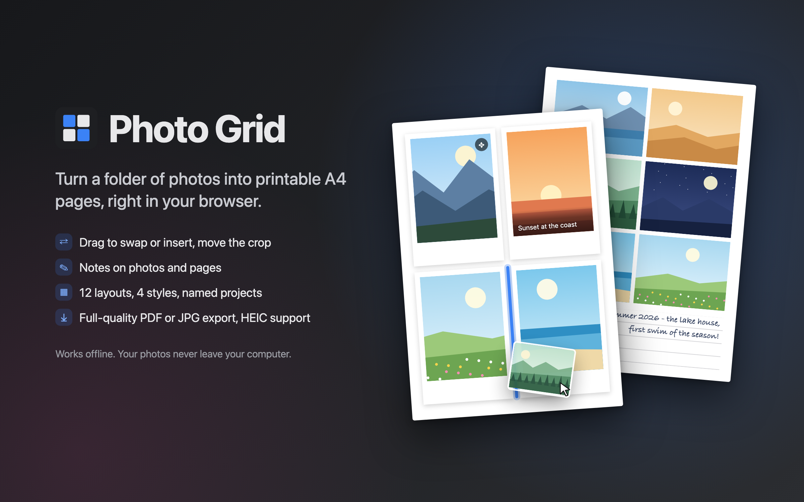
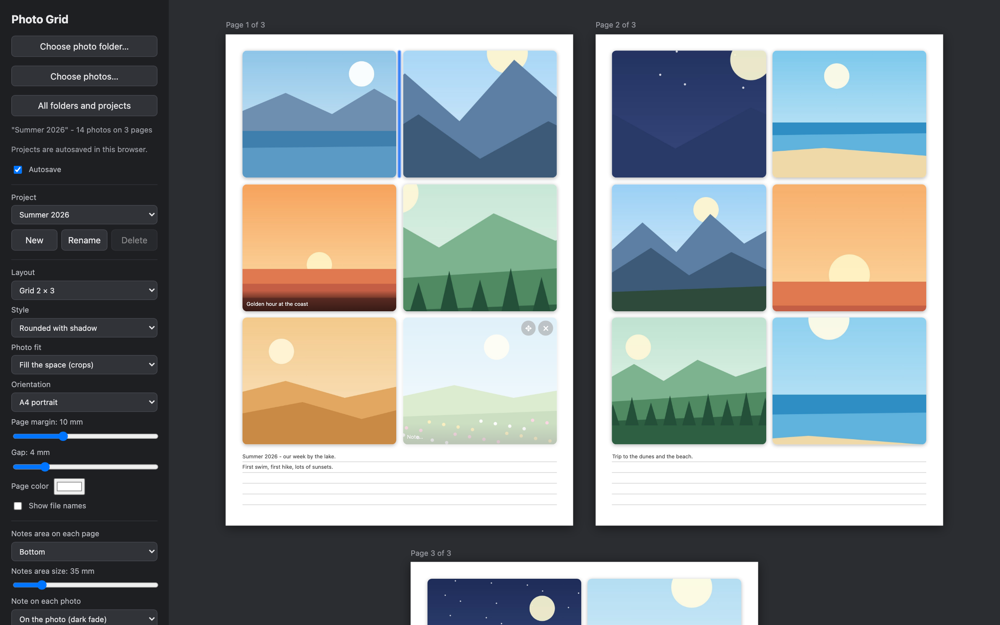

# Photo Grid



**[Open Photo Grid](https://philjay.github.io/photo-grid/)**



Arrange photos from a folder into printable A4 pages, add notes, and export them as a full-quality PDF or as one JPG per page plus a zip. Runs in the browser, works offline, and photos never leave your computer.

## Use

Open the page, click "Choose photo folder…" and pick a folder with photos. Drag photos to reorder them. A folder can hold several named projects, each with its own order, notes and settings.

Everything is saved in `photo-grid.json` inside the photo folder, and exports go into `export/<project>/` there. The browser only remembers which folder was opened last. Chrome and Edge write these files directly; in Safari and Firefox you download `photo-grid.json` and put it into the folder yourself, and exports are downloaded. Autosave, on by default, also keeps a copy of each folder's projects in the browser (a few KB per project); copies can be deleted from the start page. Instead of a folder you can also choose individual photos.

HEIC photos that the browser cannot show itself are converted in the browser with libheif. See `vendor/README.md` for its license (LGPL-3.0).

## Run locally

```sh
python3 -m http.server 8000
```

Then open http://localhost:8000.

## Publish

Published with GitHub Pages from `main` at https://philjay.github.io/photo-grid/. After the first visit the app also works offline.

The README graphics use drawn dummy pictures, no real photos. `docs/feature.html` renders the first one.
